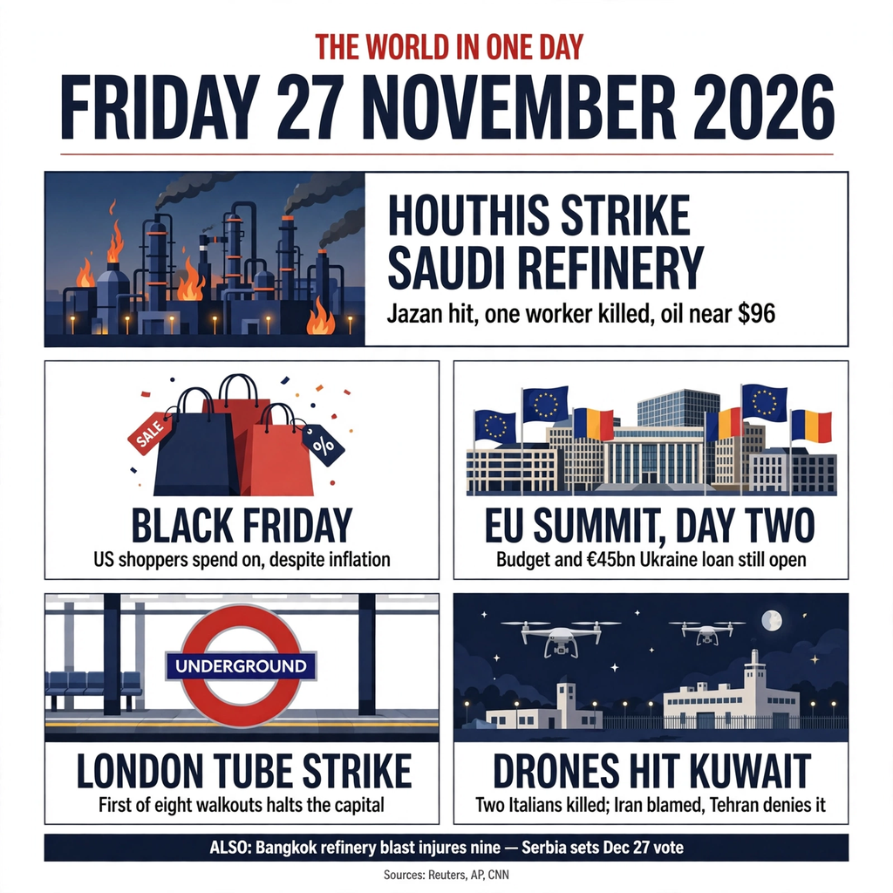

# Friday 27 November 2026 — The World in One Image

[](https://make.fun/bounty/news-image-20261127)
[](https://make.fun/bounty/news-image-20261127)
[](https://make.fun/bounty/news-image-20261127)

An entry for the [make.fun bounty "Sum up 27 November's world news in one image"](https://make.fun/bounty/news-image-20261127).



A flat-vector editorial front page summing up the world's news of **Friday 27 November 2026**, as reported in the early hours of that day. `main.ts` (Node 22, standard library only) copies `entry.png` to `$MAKEFUN_OUTPUT_DIR/entry.png` (default `/output`).

## The stories in the image

1. **Houthis strike Saudi refinery** — Yemen's Houthis attacked Saudi Aramco's Jazan refinery on Thursday; a projectile started a fire, killed one worker and temporarily halted some operations at the 400,000-barrel-a-day plant — the second major Saudi refinery hit in two days, after Ras Tanura. Brent crude rose toward $96. Sources: [Reuters](https://www.reuters.com/world/middle-east/saudi-led-coalition-says-houthis-attacked-aramcos-jazan-refinery-2026-11-26/), [CNN](https://www.cnn.com/2026/11/26/middleeast/houthi-saudi-oil-refinery-strike-satellite-imagery-intl?cid=external-feeds_iluminar_meta).
2. **Black Friday** — US shoppers hit the sales on Friday 27 November; holiday spending is forecast up 4–6% on last year, but with inflation at 3.8% most of the gain is higher prices, and 82% of consumers say they are managing holiday costs. Source: [Reuters, 27 November 2026](https://www.reuters.com/business/retail-consumer/cautious-consumers-gear-up-black-friday-inflation-woes-bite-2026-11-27/).
3. **EU summit, day two** — EU leaders resume talks in Brussels on Friday over the bloc's €1.6 trillion long-term budget and a proposed €45 billion loan for Ukraine, with the conclusions due on Friday and a deal aimed for December. Sources: [AP](https://www.reflector.com/news/national/eu-leaders-split-over-budget-spending-and-a-49-billion-loan-to-ukraine/article_2de4548f-1652-54af-b5ba-b83952609434.html), [Reuters via Devdiscourse](https://www.devdiscourse.com/article/international/4012763-eu-leaders-wrestle-to-le-pen-proof-budget-and-lock-in-ukraine-funding?amp).
4. **London Tube strike** — London Underground drivers began the first of eight 24-hour winter walkouts; the strike runs into Friday 27 November, with no service on the Circle and Piccadilly lines and disruption across the network. Source: [Reuters](https://www.reuters.com/business/world-at-work/london-tube-drivers-kick-off-first-eight-days-winter-strikes-2026-11-26/).
5. **Drones hit Kuwait** — Two Italian technicians working for Rheinmetall Italia were killed in a drone attack on a Kuwaiti air-defence site; Kuwait and Italy blamed Iran, and Tehran denied involvement. Sources: [Reuters](https://www.reuters.com/world/asia-pacific/two-italians-killed-iranian-drone-attack-kuwait-italy-says-2026-11-26/), [CNN](https://www.cnn.com/2026/11/26/middleeast/italians-killed-iranian-attack-kuwait-intl?cid=external-feeds_iluminar_meta).

Also in the footer ticker: an explosion at Bangkok's Bangchak refinery injured nine people and shut the plant ([CNN](https://www.cnn.com/2026/11/26/asia/thailand-bangkok-explosion-fire-intl?cid=external-feeds_iluminar_meta), [Reuters](https://www.reuters.com/business/energy/thailands-bangchak-shuts-all-units-bangkok-refinery-after-fire-2026-11-26/)), and Serbia set an early presidential election for 27 December ([Reuters](https://www.reuters.com/world/serbia-presidential-election-set-december-27-2026-11-26/)).

## Run it

```sh
mkdir -p out && MAKEFUN_OUTPUT_DIR=out node main.ts
```

This writes `out/entry.png`, byte-identical to `entry.png` in this repository (1024×1024 PNG, under 1 MiB).

## License

MIT — see [LICENSE](LICENSE).
